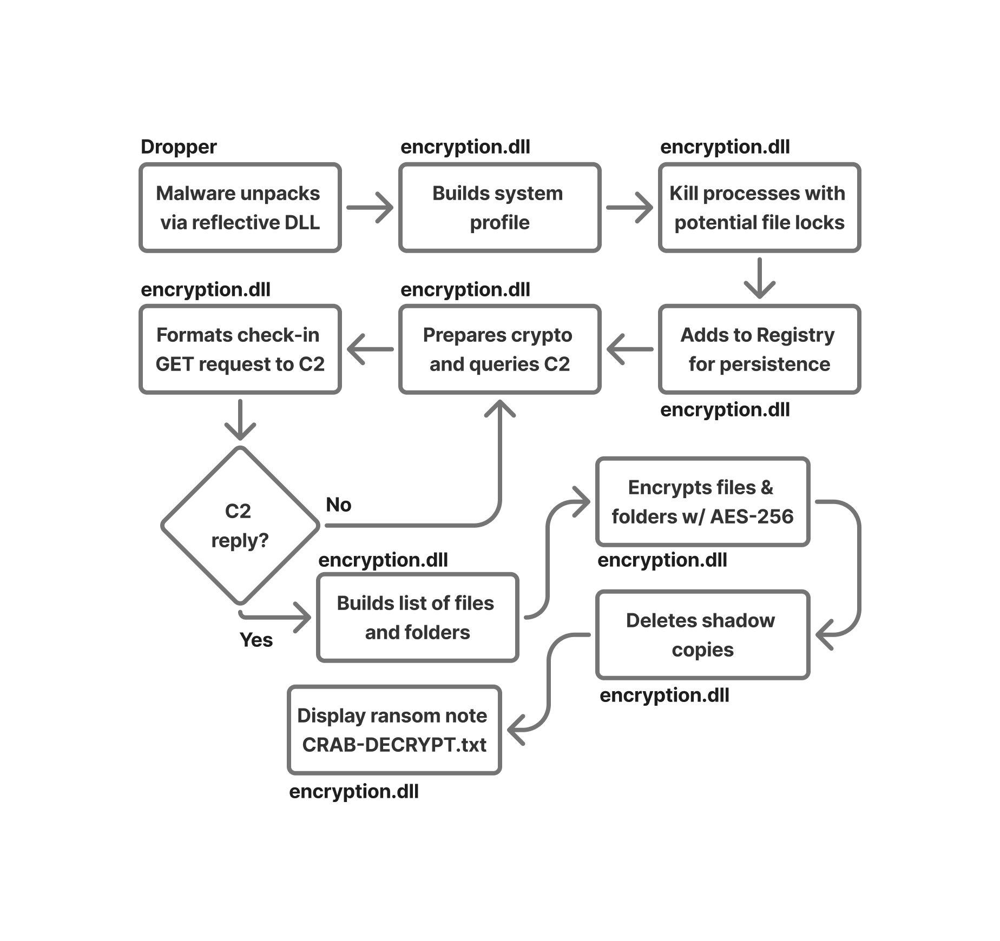

## 2. GandCrab v2
SHA256 hash for sample: cd82d7b93db1edbe805a1db8680bdd883259a02f7d4ac00b543a45a9399e2e6b (obtained from MalwareBazaar)
### Entry Point
The entry point of the program can be found under Functions in Ghidra under the Symbol Tree. The entry point is just the `entry` function.

### Primary Functions and APIs
* `entry` -> Begins the program
* `CryptExportKey` -> Exports a crypto key into a secure format
* `CryptGetKeyParam` -> Gets parameters for a crypt key
* `CryptImportKey` -> Imports a crypto key
* `CryptEncrypt` -> Encrypts plaintext data
* `CryptDecrypt` -> Decrypts ciphertext data
* `RegCreateKeyExW` -> Creates a registry key
* `RegCloseKey` -> Closes a registry key handle
* `RegQueryValueExW` -> Retrieves data from a registry value
* `InternetCloseHandle` -> Closes an internet session handle
* `HttpSendRequestW` -> Sends an HTTP request to a server
* `InternetConnectionW` -> Connects to a server or site
* `HttpOpenRequestW` -> Creates an HTTP request handle
* `InternetOpenW` -> Initializes WinINet for network use
* `InternetReadFile` -> Reads data downloaded from the internet
* `CryptStringToBinaryA` -> Converts an encoded string to binary
* `CryptBincaryToStringA` -> Converts binary data to an encoded string
* `CreateProcessW` -> Launches a new process
* `ReadFile` -> Reads data from a file
* `WriteFile` -> Writes data to a file
* `CreateFileW` -> Creates a file

### Program Flow
1. Starts with `entry`
2. Calls a couple functions to gather information that is used later.
    * `aPc_user`, `aPC_name`, `aPc_group`, `aAv`, `aPc_lang`, `aPc_keyb`, `aOs_major`, `aOs_bit`, `aRansom_id`, `aHdd`, `aIp`
3. Checks to see if keyboard layout is Russian and writes an integer representation of that result.
4. Gets a list of fixed drives on the system. It will then combine information about the system and drives and forward it to a C2 server.
5. Creates a mutex with some system information with a generated ID.
6. The malware then cycles through a hardcoded list of other processes potentially on the system that could lock certain files, allowing the malware to then encrypt them.
7. Then it calls the crypto functions to generate the public and private keys. It uses standard Microsoft crypto libraries through API calls from `Advapi32.dll`, and it calls `CryptGenKey` with the RSA algorithm in `FUN_100062b0`.
8. A loop begins where if it succeeds, it will continue to the encryption section, otherwise it will continue looping until it eventually succeeds. If it never succeeds, it will never encrypt anything.
    * Sends a GET request to `ipv4bot.whatismyipaddress.com` and saves the returned IP address and adds it to get a GET request string built with system information included.
    * Converts a binary chunk, which includes the RSA public key stored earlier, to base64 through the `CryptBinaryToStringA` API with the `CRYPT_STRING_NOCRLF` and `CRYPT_STRING_BASE64` parameters. This is added to the existing GET string being built.
    * Calls `createsChild_getIpOfGrandcrab_bit_usingCustomDNS` to spawn a NSlookup child process that sends the GET request that was built to the C2 server.
    * If the server is not reachable or if an error occurs, this process repeats until it makes a connection with the server or is closed manually.
9. If connection is made successfully, the program will open a thread to begin the encryption functionality. It also opens another thread that creates a window and names itself Firefox. The window has code that will copy itself into a temp directory and it will set up in the registry.
10. The window that adds itself to the registry does so to establish persistence.
11. As it encrypts files, if it encounters a file or folder that matches one of the stored file names or folder names, it will skip it.
12. Finally, the program will remove any shadow copies to prevent the system from being restored to a working state. Then, it reboots the system and presents the ransom note.

### Important Strings
* List of programs and processes that GandCrab will close (`sqlagent.exe`, `onenote.exe`, `mydesktopservice.exe`, etc.)
* List of files names and directories that the ransomware is ignoring (`boot.ini`, `Program Data`, `Windows`, `Tor Browser`, etc.)
* String for ransomware message that would display on a victim’s computer
* `ipv4bot.whatismyipaddress.com` for sending GET request used in larger GET request that is being built.
* Bonus: “fabian wosar <3” string highlighting the security researcher from Emsisoft who wrote the decrypter for gandcrab v1

### Behavior

### Exploited Vulnerabilities
* None, it relied on social engineering, web-based delivery mechanisms, and exploit kits.

### Spread Method
This ransomware was primarily spread through malicious spam, malware advertising (malicious ads on legitimate websites), and compromised websites.

### Exploitation Method
This ransomware did not have any exploit methods itself, instead it relied on other exploits that could get the ransomware (or the payload in this case) into systems. GandCrab is a Ransomware-as-a-Service (RaaS), so the affiliates would choose how it would spread and what it would exploit to infect systems and leverage payments.

### Encryption Method
This malware uses an asymmetric RSA encryption algorithm to protect file-specific AES and then AES-256 to encrypt individual files.
