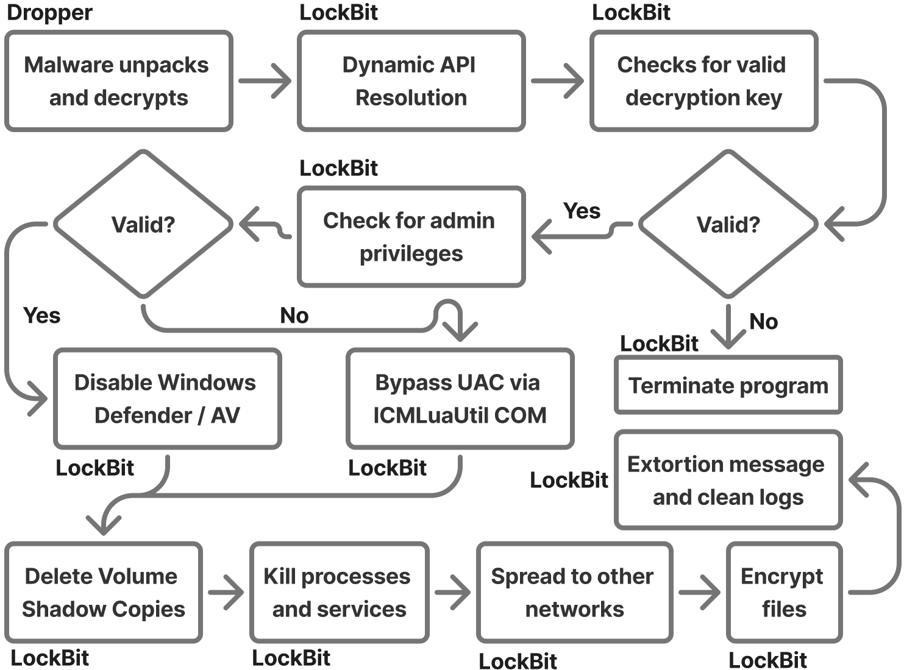

## 3. LockBit 3.0
SHA256 hash for sample: 86e17aa882c690ede284f3e445439dfe589d8f36e31cbc09d102305499d5c498 (obtained from MalwareBazaar)
### Primary Functions
- **entry**: Begins the program
- **CreateFileW**: Create file
- **ReadFile**: Read file
- **WriteFile**: Write file
- **VirtualAlloc**: Reserve, commit, or change state of pages in virtual address space
- **CreateThread**: Create thread
- **NtTerminateProcess**: End process
- **KERNEL32.dll, USER32.dll, gdi32.dll**: 27 decoy functions are stored between these 3 DLLs that are never used for ransomware functionality, but are called with the outputs discarded to make the program look like a benign Windows GUI application.

### Program Flow
- Starts with `entry`.
- The program gets the addresses for two functions, `RtlCreateHeap` and `HeapAlloc`.
- It then calls a function that loads APIs, taking the destination address to write the APIs, source address from `.data` section containing API hashes, base address of heap, and `HeapAlloc` API address as parameters.
- This function that loads the APIs first loads the right DLL from the file system by calling another function that searches the System directory to find the `.DLL` by API calls `FindFirstFileW` and `FindFirstNextW`. Next, it calls a low-level API `LdrLoadDll` to load the DLL. When it finishes loading the DLL, it uses a random number generator to write shellcode that is used later to call the APIs instead of simply writing the API addresses.
- Once the import address table is set up, LockBit checks if the OS is greater than Windows Vista and then proceeds to load its configuration. The configuration is encrypted and Aplib compressed, and it contains the decryption key, config size, and config data.
- Next, it calls the decryption routine to unlock the configuration using the decryption key and PRNG (Pseudo Random Number Generator). Once it is decrypted, LockBit decompresses the configuration using Aplib. The decompressed configuration includes 128 bytes for the RSA key (used for ransomware file encryption), 32 bytes for the affiliate ID data, and 24 bytes for the config flags that are used to toggle functionalities of LockBit (file encryption, terminating processes/services, self-destruct, etc.). Everything else is encoded through Base64.
- LockBit then checks the system language using `NtQueryInstallUILanguage` and `ZwQueryDefaultUILanguage` functions from `ntdll` and checks the output to see if it belongs to a Slavic language.
- If the feature is enabled by the Affiliate, the program will kill blacklisted processes and services from its configuration.
- For encryption, the program uses a thread pool to rapidly encrypt the machine’s files.
- If the self-destruct mechanism is enabled, the program will drop a separate payload that removes the LockBit binary from the system.

### Important Strings
- Very odd, seemingly Regex string: `*t.=s\t*6t'=T+~wt=`
- List of whitelisted directories to avoid encrypting
- List of whitelisted file names to avoid encrypting
- List of whitelisted file extensions to avoid encrypting
- Whitelisted computer name: `eSyn4wAAAAD=`
- Lists of processes and services to terminate for control of files if feature is enabled.
- List of Active Directory username and password credentials that are Base64 encoded and used to access AD accounts.
- String for ransomware note left on victim’s computer

### Behavior

### Exploited Vulnerabilities
- None, it relied on social engineering, web-based delivery mechanisms, and exploit kits.

### Spread Method
- This ransomware was spread through phishing emails and malicious attachments, compromised or brute-forced Remote Desktop Protocol credentials, or valid/stolen enterprise accounts.

### Exploitation Method
- This ransomware did not always come with any built-in exploits as it was used as one component in a larger combination of tools. It has been combined with CVE-2018-13379 that allowed it to exploit a path traversal vulnerability in Fortinet FortiOS SSL VPN, helping it to gain initial network access. This ransomware was sold as a part of a Ransomware-as-a-Service (RaaS) model, with the affiliates determining what other tools to combine it with.

### Encryption Method
- This malware uses symmetric encryption for file content with either a ChaCha20, AES-256, or Salsa20 algorithm. For protecting its keys, it would use asymmetric encryption with the RSA-2048 algorithm (or Curve25519 with XChaCha20).
